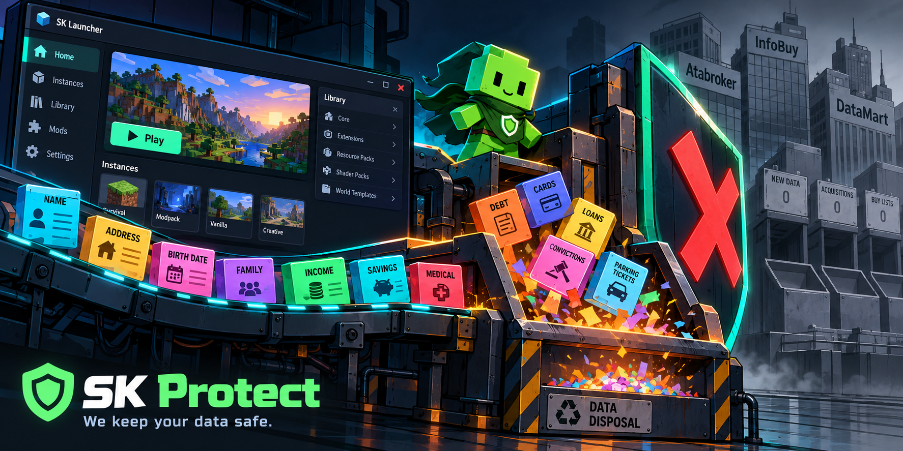

<p align="center">
  
</p>

<h1 align="center">SK Protect</h1>

<p align="center"><strong>Independent patches for SKlauncher 4.0.54 on Linux x86_64</strong></p>

<p align="center">Keep the launcher you already use. Choose only the protection and workflow improvements you want.</p>

<p align="center"><em>Are you fed up with being sent away from the mod library after an install? Concerned about how many companies can correlate activity online? Want a saved bank of mods that can be applied to every new instance? These patches are for you.</em></p>

> [!IMPORTANT]
> SK Protect is an unofficial community project. It is not affiliated with or endorsed by SKlauncher, SKmedix, Mojang, or Microsoft. It does not redistribute SKlauncher. You supply the official AppImage from your own computer, and the patch creates a separate local copy.

## What this project is — and is not

SK Protect is a guarded, version-specific patch kit for the official **SKlauncher 4.0.54 Linux x86_64 AppImage**.

This project is **not** an accusation that SKlauncher developers collect, sell, or misuse personal information. We found no evidence of that in the code paths inspected. The purpose is to give privacy-conscious users a narrower, inspectable launcher configuration and to add useful workflow features.

The concern is the wider data ecosystem: optional activity, identifier, analytics, Discord Rich Presence, profile, and remote-service routes can pass through services operated by other companies. Those companies may have their own collection, correlation, retention, or data-broker relationships. SK Protect reduces selected optional routes; it does not claim that SKlauncher is harvesting data.

The patch is not a firewall, anonymity tool, antivirus, or replacement for Microsoft/Mojang authentication. Minecraft, Java, LAN, Realms, Microsoft/Mojang services, and a mod’s own servers remain outside this launcher-specific Electron filter.

## Choose a patch

| Download/build choice | What it does | Use this when |
|---|---|---|
| **Patch 1 — Privacy** | Disables launcher analytics, Discord Rich Presence, automatic updating, and selected launcher-owned background routes while retaining explicitly allowed news and public-server routes. | You want the privacy-focused launcher controls only. |
| **Patch 2 — Multi-Instance Mod Installer** | Keeps Content Hub open after installs and adds the tested multi-instance install selector with green/red/unavailable/uninstall states. | You want installation quality-of-life improvements without the privacy changes. |
| **Patch 3 — Preferred Mods Installer** | Saves a personal mod list, resolves compatible releases per instance, and optionally applies enabled mods after every new instance is created. | You want automatic essential/preferred mods. |
| **Final Version 1.0 — Combined** | Applies Patch 1 + Patch 2 + Patch 3 in one guarded build. | You want the complete SK Protect experience. |

The repository contains transformation scripts and verification code only. It does **not** contain the SKlauncher AppImage, ASAR, extracted launcher bundle, accounts, worlds, instances, or game data.

## Quick start — Final Version 1.0

1. Download a fresh official **SKlauncher 4.0.54 Linux x86_64 AppImage** from the [official SKlauncher download page](https://next.skmedix.pl/downloads).
2. Make a safety copy of the original AppImage and keep the original unchanged for rollback. Do not overwrite it.
3. Download this repository with GitHub’s **Code → Download ZIP**, then extract it beside your AppImage. (You can also clone the repository with Git.)
4. Open a terminal in the extracted `SK-Protect` folder and make both files executable:

```bash
chmod +x SKlauncher-4.0.54.AppImage patch.sh
```

5. Build the combined protected copy:

```bash
./patch.sh combined ./SKlauncher-4.0.54.AppImage ./SK-Protect-Final-1.0.AppImage
```

6. Launch the new file:

```bash
./SK-Protect-Final-1.0.AppImage
```



The source AppImage remains unchanged. The normal SKlauncher profile is also left untouched during patching. Keep the original file as your rollback option.

## Individual patches

### Patch 1 — Privacy

```bash
./patch.sh privacy-only ./SKlauncher-4.0.54.AppImage ./SK-Protect-Privacy.AppImage
```

Patch 1 disables launcher analytics, Discord Rich Presence, automatic updating, and secure DNS in launcher settings; removes the stored analytics client identifier during settings load; and blocks selected remote configuration, profile, library-patch, and tracking routes. It retains exact HTTPS `GET` routes needed for launcher news, public server lists, numeric server details, numeric public icons, and safe single-file public banners.

It does not block Microsoft/Mojang services, the Java game, LAN, Realms, or a mod’s own server connections.

### Patch 2 — Multi-Instance Mod Installer

```bash
./patch.sh workflow ./SKlauncher-4.0.54.AppImage ./SK-Protect-Multi-Instance-Mod-Installer.AppImage
```

Patch 2 keeps the Content Hub in place after a successful background installation. You are no longer sent back to the instance library as soon as a mod finishes installing, so you keep your place and can continue reading. It also allows a compatible mod to be selected for multiple existing instances; explains green **Selected**, red **Not selected**, dark-red **Not available**, and yellow **Uninstall** states; supports reversible uninstall marking and confirmation through SKlauncher’s normal manifest-aware removal route; and preserves the original single-instance installation path.

### Patch 3 — Preferred Mods Installer

```bash
./patch.sh preferred-mods ./SKlauncher-4.0.54.AppImage ./SK-Protect-Preferred-Mods-Installer.AppImage
```

Patch 3 lets you build a personal list once and reuse it. Add individual Modrinth or CurseForge mods, enable or disable entries, review compatibility for an instance, turn individual installs off before confirming, and enable **Offer Preferred Mods for new instances** so enabled compatible mods are applied automatically after each new instance is created.

The list stores project identity, provider, display name, icon, order, and enabled state. It does not store account tokens, chosen JAR URLs, version IDs, or instance paths.

## Clean installation test

For a genuinely clean test that cannot use your normal `~/.sklauncher` or XDG folders:

```bash
./run-isolated.sh ./SK-Protect-Final-1.0.AppImage "$HOME/SK-Protect-clean-test"
```

Use a new empty test directory for every run. This is for testing only; it does not migrate or modify your normal launcher profile.

## Requirements and limitations

- Linux x86_64.
- Official SKlauncher 4.0.54 AppImage.
- Node.js 18 or newer and `mksquashfs` for local builds.
- The patch is guarded. If the expected version-specific code is absent or duplicated, it stops instead of guessing.
- A future SKlauncher version may require a new patch release.
- Generated AppImages are not committed to this repository.

## Updates and version compatibility

The protected build disables SKlauncher’s automatic updater so that an update cannot silently replace the patched files. You can still update manually: download the newer official AppImage from SKlauncher, keep the current protected copy as a rollback, and run a new SK Protect release against the new official file.

This Final Version 1.0 release targets **SKlauncher 4.0.54**. The patch pipeline is deliberately guarded by version-specific source checks; it stops if the expected launcher code is missing or has changed instead of producing an unverified build. A future SKlauncher release therefore needs a new SK Protect compatibility release. Do not apply this release to a different launcher version and assume the protections or workflow changes carried over.

## Repository contents

| File | Purpose |
|---|---|
| `patch.sh` | User-facing wrapper for Patch 1, Patch 2, Patch 3, or the combined build |
| `build-appimage.sh` | Extract, patch, verify, and repack pipeline |
| `privacy-patch.js` | Patch 1 transformations |
| `apply-fix.js` | Patch 2 workflow transformations |
| `preferred-mods-patch.js` | Patch 3 main/preload data API |
| `preferred-mods-ui-patch.js` | Patch 3 interface and new-instance hook |
| `run-isolated.sh` | Disposable clean-profile launcher |
| `verify-*.js` | Guarded static and behavioural checks |
| `images/` | Project artwork and explanatory diagrams |

See [CHANGELOG.md](CHANGELOG.md) for release history and [RELEASE_NOTES.md](RELEASE_NOTES.md) for the Final Version 1.0 summary.

## Feedback and upstream contact


If you contact the SKlauncher developers, please be aware that this is an independent project, not something developed by them. We welcome their comments and technical review. We do not claim to have their permission to create this patch, and we have not redistributed their proprietary code or the launcher itself.
